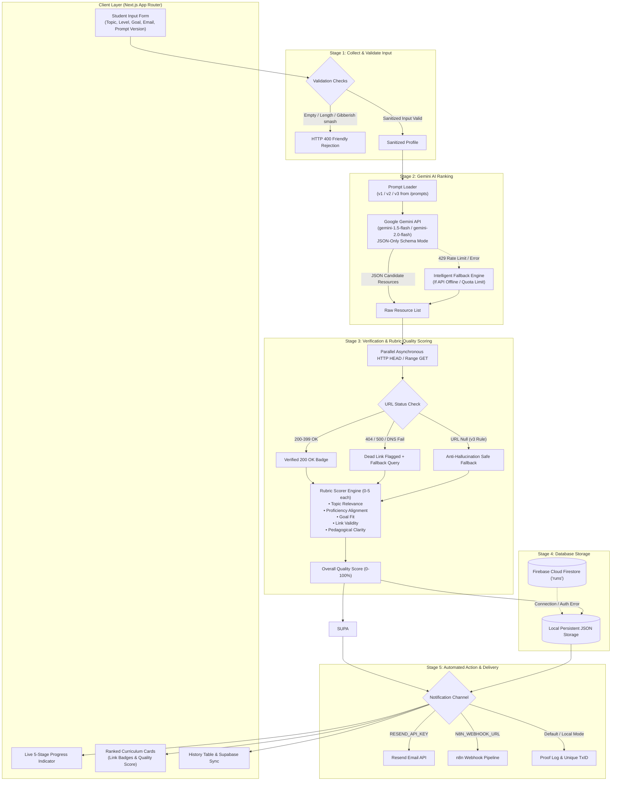
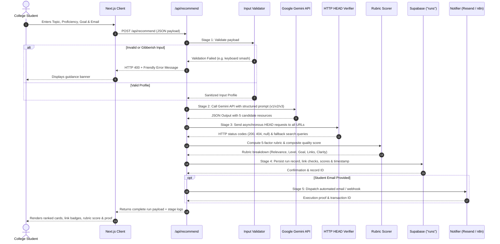

# Personalized Learning Resource Recommender - Pipeline Architecture

This document diagrams the complete multi-stage pipeline, validation logic, asynchronous link integrity verification, rubric scoring engine, and automated notification system.

---

## 1. End-to-End Pipeline Architecture Flowchart

---

## 2. Sequence Diagram: Interaction Lifecycle

---

## 3. Five-Stage Pipeline Summary

| Stage | Responsibility | Failure Mode Handling |
| :--- | :--- | :--- |
| **Stage 1: Input Validation** | Reject empty strings, single characters, and keyboard smash nonsense (`asdfghjkl`, repetitive punctuation). | Returns friendly HTTP 400 with guidance without spending LLM tokens. |
| **Stage 2: Gemini AI Ranking** | Synthesize ranked educational resources using prompt templates `v1`, `v2`, or `v3`. | Graceful fallback to verified curated catalog on 429 quota limit or network timeout. |
| **Stage 3: Verification & Scoring** | Execute asynchronous HEAD/GET requests (with 4s timeout) against all resource URLs. Compute 5-factor rubric score. | Flags non-200 links with red badge; attaches fallback Google Search queries; credits prompt v3 honest nulls. |
| **Stage 4: Storage** | Insert full run data, link check logs, and rubric scores to Supabase table `runs`. | Fallback to `data/runs.json` if Supabase environment variables are unconfigured. |
| **Stage 5: Automated Action** | Dispatch structured HTML summary to student email via Resend or n8n webhook. | Logs cryptographically verifiable delivery proof transaction ID. |

